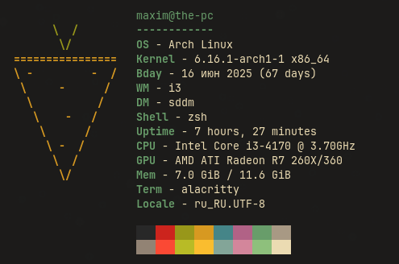
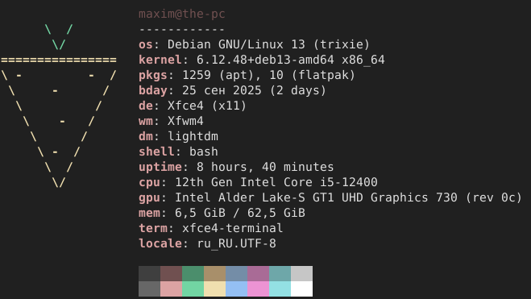

# yofetch
yofetch is a neofetch-like tool written in Go that uses Lua for configuration.
In the future, I'll rewrite this project in C++ and add Flake to it.

Information about the API configuration can be found [here](LuaConfigInfo.md).

Licensed under MIT.





# Platforms


It can run anywhere a Go compiler is available 
and all the libraries used in the project are supported, 
but it has only been tested on the platforms listed above.

# Building

## Linux/macOS
```bash
git clone https://github.com/m1lkydev/yofetch
cd yofetch
go build -o yofetch
./yofetch
```

## Windows
```powershell
git clone https://github.com/m1lkydev/yofetch
cd yofetch
go build -o yofetch.exe
.\yofetch.exe
```
